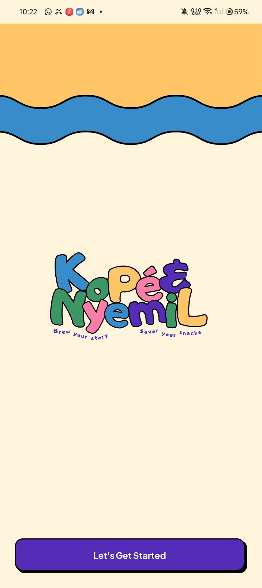
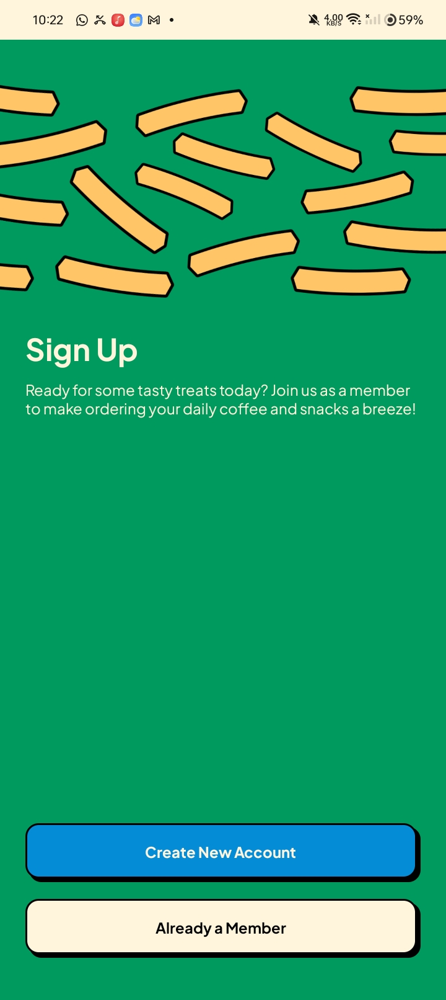
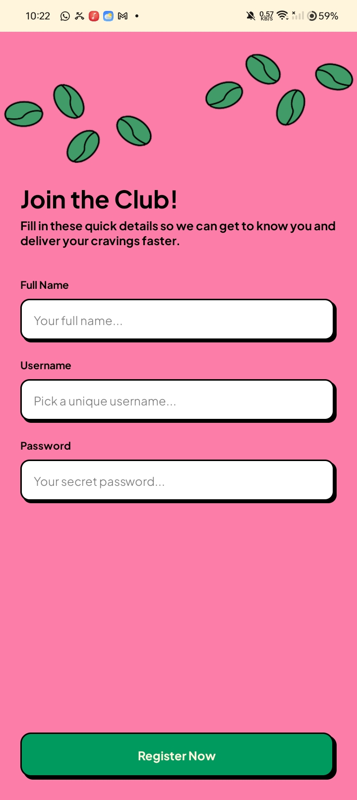
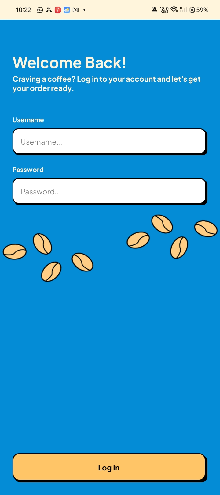
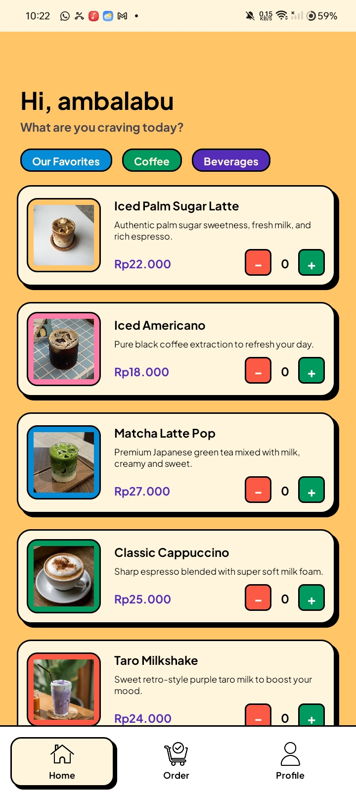
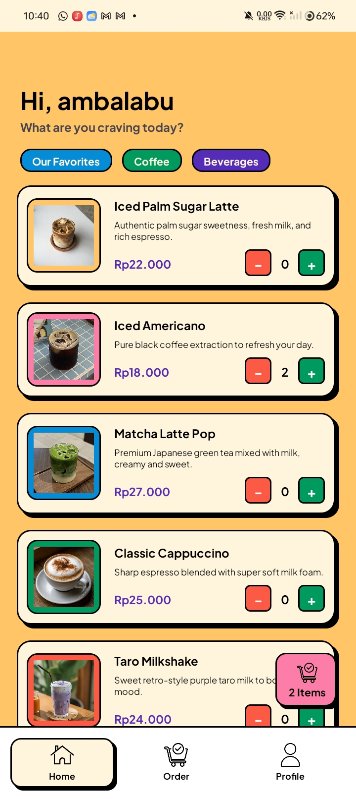
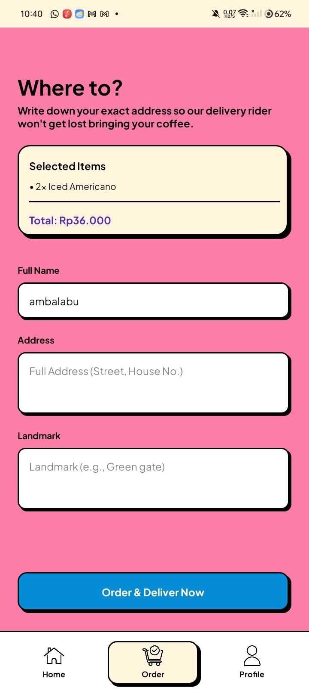
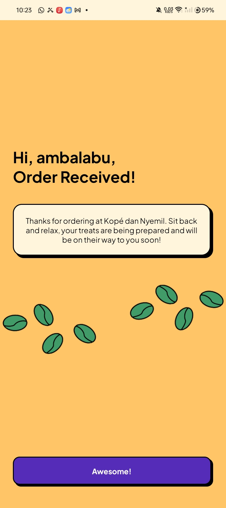
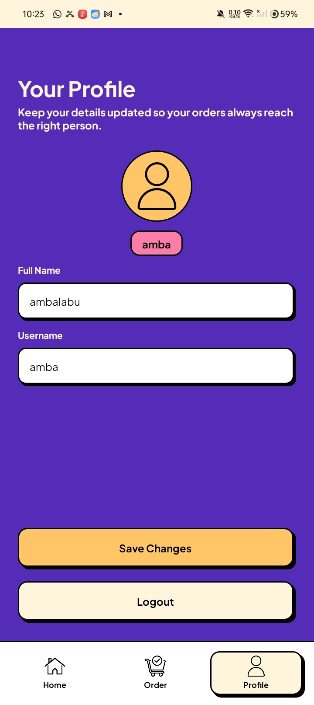

# ☕ Kopi dan Nyemil

Aplikasi mobile Android untuk memesan kopi dan camilan, dibuat sebagai **Tugas UTS Pemrograman Mobile**. Tampilan mengusung tema **retro pop**: warna-warni kontras, border hitam tebal, bayangan keras, dan ilustrasi dekoratif di setiap halaman.

> *Get a taste of your wish.*

## 📑 Daftar Isi

1. [Fitur](#-fitur)
2. [Panduan Penggunaan (per Halaman)](#-panduan-penggunaan-per-halaman)
3. [Alur Aplikasi](#️-alur-aplikasi)
4. [Teknologi](#️-teknologi--spesifikasi)
5. [Palette Warna](#-palette-warna-retro)
6. [Struktur Project](#-struktur-project)
7. [Data Menu Dummy](#-data-menu-dummy-10-item)
8. [Cara Menjalankan](#️-cara-menjalankan)
9. [Pembuat](#-pembuat)

---

## ✨ Fitur

**Akun & Autentikasi**
- **Splash / Welcome**: halaman pembuka dengan logo dan hiasan ombak retro.
- **Sign Up**: pintu masuk dengan pilihan *Create New Account* atau *Already a Member*.
- **Register**: membuat akun dengan nama lengkap, username, dan password; semua kolom wajib diisi. Akun yang tersimpan hanya satu, jadi mendaftar lagi akan menimpa akun sebelumnya.
- **Login**: autentikasi username dan password. Username tidak membedakan huruf besar/kecil, password membedakan; spasi di tepi otomatis dibuang. Tersedia akun demo `admin` / `123456` yang berlaku selama belum ada akun yang didaftarkan.
- **Logout**: keluar dari akun dan kembali ke Sign Up; tombol Back tidak bisa kembali ke halaman sebelumnya.

**Pemesanan**
- **Daftar menu** (10 item) memakai `RecyclerView`, lengkap dengan foto, deskripsi, dan harga.
- **Pengatur jumlah (+ / −)** di setiap menu untuk memilih berapa porsi yang dipesan.
- **Keranjang melayang**: muncul otomatis saat ada menu yang dipilih, menampilkan jumlah item, dan bila diketuk langsung membuka tab Order.
- **Ringkasan pesanan**: halaman Order menampilkan daftar menu terpilih beserta **total harga**.
- **Alamat pengiriman**: nama penerima, alamat lengkap, dan patokan.
- **Validasi pesanan**: order ditolak jika keranjang kosong atau data pengiriman belum lengkap.
- **Konfirmasi pesanan**: halaman sukses setelah order dikirim; keranjang otomatis dikosongkan.

**Profil & Navigasi**
- **Profile**: ubah *Full Name* dan *Username*, simpan dengan *Save Changes*; nama baru langsung dipakai di sapaan Home dan isian otomatis form Order.
- **Bottom Navigation** (Home, Order, Profile) berbasis **Fragment** di dalam `HomeActivity`.

**Tampilan**
- Tema retro: border 2dp, bayangan keras, tombol yang "menekan" saat disentuh.
- Setiap halaman punya warna latar sendiri dan ilustrasi dekorasi (kopi, kentang goreng, ombak).

---

## 📱 Panduan Penggunaan (per Halaman)

> Simpan semua screenshot di folder `screenshots/` dengan nama seperti pada tabel.

### 1. Splash / Welcome



Halaman pertama yang muncul saat aplikasi dibuka, berisi logo **Kopi dan Nyemil**.

**Cara pakai:**
1. Lihat logo dan tagline aplikasi.
2. Ketuk tombol **Let's Get Started** untuk lanjut ke halaman Sign Up.
3. Halaman ini hanya tampil sekali. Setelah pindah ke Sign Up, tombol Back pada HP akan menutup aplikasi, bukan kembali ke Splash.

---

### 2. Sign Up



Pintu masuk untuk menentukan apakah kamu pengguna baru atau sudah punya akun.

**Cara pakai:**
1. Jika **belum punya akun**, ketuk **Create New Account** untuk menuju halaman Register.
2. Jika **sudah punya akun**, ketuk **Already a Member** untuk menuju halaman Login.

---

### 3. Register



Halaman untuk membuat akun baru.

**Cara pakai:**
1. Isi **Full Name** dengan nama lengkapmu.
2. Isi **Username** (pilih yang unik, dipakai untuk login).
3. Isi **Password**.
4. Ketuk **Register Now**.
5. Jika ada kolom yang kosong, muncul pesan *Semua data wajib diisi* dan akun tidak dibuat. Jika semua terisi, muncul pesan *Registrasi berhasil* dan kamu langsung masuk ke Home.

---

### 4. Login



Halaman masuk untuk pengguna yang sudah punya akun.

**Cara pakai:**
1. Isi **Username** dan **Password** akun yang sudah didaftarkan.
2. Ketuk **Log In**.
3. Jika benar, kamu masuk ke Home. Jika salah, muncul pesan *Username atau password salah*. Kolom yang kosong juga memunculkan peringatan.
4. Username tidak membedakan huruf besar/kecil (`Budi` sama dengan `budi`), tetapi password membedakan.
5. Untuk mencoba cepat, pakai akun demo: username `admin`, password `123456`. Akun demo hanya bisa dipakai kalau **belum ada akun yang didaftarkan** di perangkat; jika sudah pernah Register, login dengan akun tersebut.

---

### 5. Home (Daftar Menu)



Halaman utama berisi sapaan dengan namamu dan daftar menu kopi serta camilan.

**Cara pakai:**
1. Lihat sapaan *Hi, {nama}* di bagian atas, lalu geser (scroll) untuk melihat seluruh menu beserta foto, deskripsi, dan harganya.
2. Ketuk tombol **+** pada menu yang kamu inginkan untuk menambah jumlah porsi. Ketuk **−** untuk menguranginya (jumlah tidak bisa kurang dari 0).
3. Angka di antara tombol menunjukkan jumlah porsi yang sedang dipilih.
4. Gunakan bar navigasi di bawah (**Home**, **Order**, **Profile**) untuk berpindah halaman.

#### Memilih beberapa menu



Setelah ada menu yang dipilih, **tombol keranjang** muncul di pojok kanan bawah dan menampilkan jumlah item (misalnya *2 Items*).

**Cara pakai:**
1. Tambahkan menu sebanyak yang kamu mau dengan tombol **+**.
2. Pantau jumlah total porsi lewat tombol keranjang di pojok kanan bawah. Tombol ini hilang lagi kalau semua jumlah kembali 0.
3. Setelah selesai memilih, ketuk tombol keranjang tersebut, atau tab **Order** di bawah, untuk melanjutkan pesanan.

---

### 6. Order (Alamat Pengiriman)



Halaman untuk memeriksa pesanan dan mengisi alamat pengiriman.

**Cara pakai:**
1. Periksa kartu **Selected Items**: di sini terlihat daftar menu yang kamu pilih (contoh: `2x Iced Americano`) dan **Total** harganya. Jika masih kosong, kembali ke Home dan pilih menu dulu.
2. Periksa **Full Name**. Kolom ini sudah terisi otomatis dengan nama akunmu, dan boleh diganti jika pesanan untuk orang lain.
3. Isi **Address** dengan alamat lengkap (jalan dan nomor rumah).
4. Isi **Landmark** dengan patokan, misalnya "Pagar hijau dekat warung".
5. Ketuk **Order & Deliver Now**.
6. Jika keranjang masih kosong, muncul pesan *Pilih setidaknya 1 menu terlebih dahulu!*. Jika ada kolom yang kosong, muncul pesan *Lengkapi semua data pengiriman*. Jika semua benar, pesanan terkirim dan kamu diarahkan ke halaman konfirmasi.

---

### 7. Konfirmasi Pesanan



Halaman yang menandakan pesananmu sudah diterima.

**Cara pakai:**
1. Baca pesan **Halo {nama}, Order Received!** yang menandakan pesanan sedang disiapkan.
2. Ketuk **Awesome!** untuk kembali ke Home. Keranjang sudah kosong, jadi kamu bisa langsung memesan lagi.
3. Tombol Back pada HP tidak membawamu kembali ke form pesanan yang lama.

---

### 8. Profile



Halaman untuk melihat dan mengubah data akunmu.

**Cara pakai:**
1. Lihat avatar dan lencana username kamu di bagian atas.
2. Ubah **Full Name** dan/atau **Username** pada kolom yang tersedia. Keduanya tidak boleh kosong.
3. Ketuk **Save Changes** untuk menyimpan. Muncul pesan *Profile berhasil disimpan* dan lencana username langsung berubah. Sapaan di Home dan isian otomatis di Order akan memakai nama barumu saat halamannya dibuka kembali. Password tidak berubah.
4. Ketuk **Logout** untuk keluar dari akun dan kembali ke halaman Sign Up. Tombol Back tidak akan membawamu kembali ke Home.

---

## 🗂️ Alur Aplikasi

```
Splash → Sign Up ─┬→ Register ─┐
                  └→ Login ────┴→ HomeActivity (Fragment Host)
                                    ├── HomeFragment    (Daftar Menu + pilih jumlah + keranjang melayang ──┐)
                                    ├── OrderFragment   (Ringkasan + Alamat) ◄─────────────────────────────┘
                                    │        └→ ConfirmationActivity → HomeActivity (keranjang dikosongkan)
                                    └── ProfileFragment (Ubah data / Logout → SignUpActivity)
```

---

## 🛠️ Teknologi & Spesifikasi

| Komponen | Keterangan |
|---|---|
| Bahasa Pemrograman | Kotlin |
| Minimum SDK | API 27 (Android 8.1) |
| Target SDK | API 37 |
| IDE | Android Studio |
| Arsitektur UI | Multi-Activity + Fragment (`HomeActivity` sebagai host 3 fragment) |
| UI Components | XML Layout, Material Components (`Theme.KopiNyemil`) |
| Daftar menu | `RecyclerView` + `MenuAdapter` |
| Keranjang | `CartManager` (object/singleton yang menyimpan jumlah per menu di memori, dipakai bersama oleh Home dan Order; total harga dihitung otomatis dan diformat rupiah) |
| Manajemen sesi | `SessionManager` via `SharedPreferences` (`kopi_nyemil_prefs`) |
| Styling retro | Drawable XML (`shape`, `layer-list`, `selector`) untuk border dan bayangan |
| Aset gambar | WebP / JPG / Vector untuk ilustrasi dan foto menu |

---

## 🎨 Palette Warna Retro

| Warna | Hex | Dipakai di |
|---|---|---|
| Kuning | `#FFC567` | Home, Konfirmasi, tombol Save |
| Pink | `#FB7DA8` | Register, Order, tombol keranjang |
| Merah | `#FD5A46` | Tombol kurangi (−) |
| Ungu | `#552CB7` | Profile, tombol Start, harga |
| Hijau | `#00995E` | Sign Up, tombol Register, tombol tambah (+) |
| Biru | `#058CD7` | Login, tombol Create Account & Order |
| Cream | `#FFF4DC` | Splash, kartu, dan teks di atas warna gelap |

---

## 📁 Struktur Project

```
app/src/main/
├── java/lat/pam/kopinyemil/
│   ├── SplashActivity.kt        # Halaman pembuka
│   ├── SignUpActivity.kt        # Pilihan Register / Login
│   ├── LoginActivity.kt         # Autentikasi
│   ├── RegisterActivity.kt      # Pendaftaran akun
│   ├── HomeActivity.kt          # Host fragment + bottom navigation
│   ├── HomeFragment.kt          # Daftar menu + keranjang melayang
│   ├── OrderFragment.kt         # Ringkasan pesanan + alamat
│   ├── ProfileFragment.kt       # Ubah data akun + logout
│   ├── ConfirmationActivity.kt  # Konfirmasi pesanan
│   ├── FoodMenu.kt              # Model dan data menu dummy
│   ├── MenuAdapter.kt           # Adapter RecyclerView (termasuk tombol + / −)
│   ├── CartManager.kt           # Penyimpan isi keranjang
│   └── SessionManager.kt        # Penyimpan akun
└── res/
    ├── layout/                  # *_activity.xml, fragment_*.xml, item_menu.xml
    ├── drawable/                # foto menu, logo, dekorasi, bg_btn_*, bg_card_*, bg_box_*, bg_qty_*
    └── values/                  # colors.xml, themes.xml, strings.xml
```

---

## 🧪 Data Menu Dummy (10 Item)

Tidak memakai database. Daftar menu bersifat statis di `FoodMenu.kt`, akun disimpan di `SharedPreferences`, dan isi keranjang disimpan sementara di memori (hilang saat aplikasi ditutup, dan dikosongkan setelah order berhasil).

| Menu | Deskripsi | Harga |
|---|---|---|
| **Iced Palm Sugar Latte** | Authentic palm sugar sweetness, fresh milk, and rich espresso. | Rp22.000 |
| **Iced Americano** | Pure black coffee extraction to refresh your day. | Rp18.000 |
| **Matcha Latte Pop** | Premium Japanese green tea mixed with milk, creamy and sweet. | Rp27.000 |
| **Classic Cappuccino** | Sharp espresso blended with super soft milk foam. | Rp25.000 |
| **Taro Milkshake** | Sweet retro-style purple taro milk to boost your mood. | Rp24.000 |
| **Crispy French Fries** | Crunchy and savory fries, the perfect hangout buddy. | Rp18.000 |
| **Choco Sprinkles Donut** | Soft vintage donut with thick chocolate sprinkles. | Rp12.000 |
| **Sourdough Loaf** | Naturally fermented bread, crispy on the outside and soft inside. | Rp35.000 |
| **Nougat Toast** | Classic toast spread with mocha cream and peanuts. | Rp20.000 |
| **Classic Choco Cookie** | Crunchy cookie with melted chocolate in every bite. | Rp10.000 |

---

## ▶️ Cara Menjalankan

1. Clone repository:
   ```bash
   git clone https://github.com/<username>/<nama-repo>.git
   ```
2. Buka folder project di **Android Studio**, lalu tunggu **Gradle Sync** selesai.
3. Hubungkan perangkat Android (aktifkan USB Debugging) atau gunakan **Android Emulator**.
4. Klik **Run ▶️**.

**Akun untuk mencoba:**
- Buat akun baru lewat **Create New Account**, atau
- Langsung login dengan akun demo: username `admin`, password `123456` (hanya jika belum ada akun yang didaftarkan; kalau sudah, pakai akun tersebut atau hapus data aplikasi lewat Settings).

**Skenario uji cepat:**
1. Login dengan akun demo (atau akun yang kamu daftarkan).
2. Di Home, tambahkan 2-3 menu dengan tombol **+**.
3. Buka tab **Order**, cek ringkasan dan total, isi alamat, ketuk **Order & Deliver Now**.
4. Pada halaman konfirmasi, ketuk **Awesome!**.
5. Buka tab **Profile**, ubah nama, ketuk **Save Changes**, lalu **Logout**.

---

## 👤 Pembuat

- **Nama**: _isi nama kamu_
- **NIM**: _isi NIM kamu_
- **Mata Kuliah**: Pemrograman Mobile, UTS 2026
